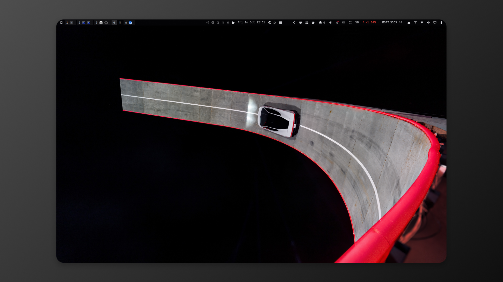
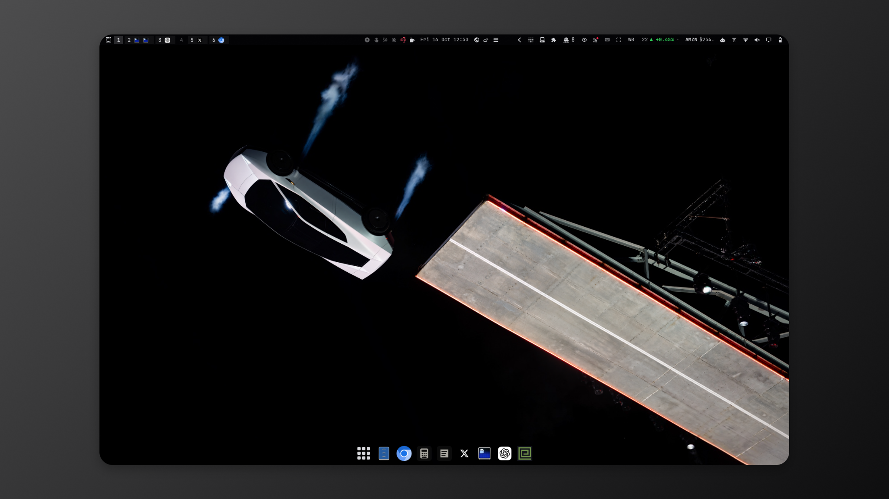

<h1 align="center">Roadster 8K</h1>

<p align="center">Near-black surfaces. Brushed silver. Vivid red.</p>

<p align="center"><a href="https://github.com/tcballard/omarchy-badges"></a></p>

A dark Omarchy Quattro theme built around the Roadster wall-ride photograph. Nine wallpapers, enhanced with two contextual image passes and packaged as lossless images at 8,192 pixels on the long edge. The wall-ride image is selected on first application.

Built from [Build Omarchy Themes](https://github.com/tcballard/build-omarchy-themes) guidance and the Omarchy theme starter by Tom Ballard. [Media and source credits](CREDITS.md).

## Desktop screenshots

Captured on my Omarchy desktop, 16 October 2026.





## Install

```bash
omarchy theme install https://github.com/tcballard/omarchy-theme-roadster-8k
```

This applies the theme and replaces an existing installation from this repository. Preserve local edits before reinstalling. Omarchy derives the installed name `theme-roadster-8k` from this repository's name.

## Design

| Role | Colour |
| --- | --- |
| Shell accent | `#FF2448` |
| Background | `#090A0F` |
| Raised surfaces | `#181A21` |
| Text | `#D7D8DC` |
| Highlights | `#F5F5F7` |
| Selection | `#382029` |

Red marks focused controls, active borders, selected rows and shell activity. Silver text stays readable against the near-black background. Terminal and editor colours retain distinct warning, error and success roles. Fonts and spacing follow native defaults.

## Wallpapers

The default is `backgrounds/01-wall-ride-8k.png`. The other eight images remain available through wallpaper cycling. Omarchy remembers your selection when switching away and back. Applying the current theme again cycles to the next wallpaper.

8K describes export dimensions, not native AI generation. Images retain their original proportions. The set includes the ROADSTER event poster at 8192 × 4608. Its original lettering is preserved; see [processing evidence](docs/POSTER-PROCESSING.json).

## Validation

Quattro generation, Git-installed staging, wallpaper selection and switching were checked offline against upstream commit `51bfd1dbaa1b5f790e19623faf2745945d40c796`. Text contrast is 13.89:1; accent contrast is 5.27:1. [Validation details](docs/VALIDATION.md).

Real desktop screenshots are shown above; the full live acceptance checklist remains pending. [Acceptance record](docs/ACCEPTANCE.json). No marketplace listing or stable release is claimed.

## Development

```bash
./tests/run
sha256sum -c SHA256SUMS
```

[Development](docs/DEVELOPMENT.md) · [Architecture](ARCHITECTURE.md) · [Release process](docs/RELEASE.md)

## Licence

Configuration and project code: [MIT](LICENSE). Wallpaper rights are separate; see [credits](CREDITS.md).
